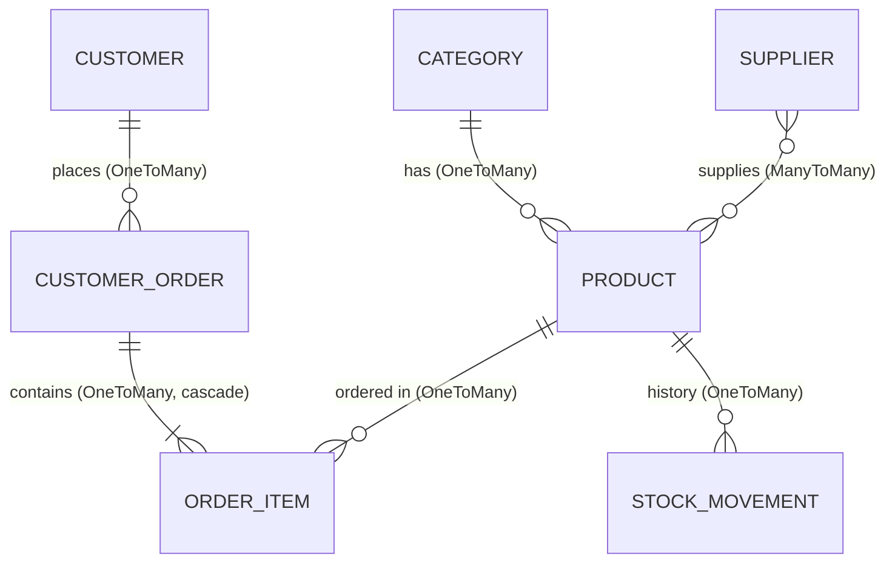

# spring-ds1

Application Spring Boot de gestion des commandes et du stock — *DS1 Web Development: Spring Boot project*.

REST API (Spring Boot 3, Spring Data JPA, PostgreSQL, Lombok) to manage a shop's catalogue, suppliers,
customers, orders and stock. Everything can be tested with Postman.

---

## 1. Business context

A small shop sells products grouped in categories. Products are bought from several suppliers.
Customers place orders made of several lines (product + quantity). Every order automatically
**decreases the stock** (and logs a stock movement); cancelling or deleting an active order **puts the stock back**.
Stock managers can also record manual entries/exits (deliveries, losses...) and ask which products must be reordered.

## 2. Entities and relationships (7 entities)



| Entity | Main fields | Relationships |
|---|---|---|
| `Category` | name (unique), description | 1 → N `Product` |
| `Supplier` | name, email, phone | N ↔ N `Product` (join table `product_suppliers`) |
| `Product` | name, sku (unique), price, stockQuantity, reorderLevel | N → 1 `Category`, N ↔ N `Supplier` |
| `Customer` | firstName, lastName, email (unique), phone, city | 1 → N `CustomerOrder` |
| `CustomerOrder` (table `orders`) | orderDate, status, totalAmount | N → 1 `Customer`, 1 → N `OrderItem` |
| `OrderItem` | quantity, unitPrice | N → 1 `CustomerOrder`, N → 1 `Product` |
| `StockMovement` | type (IN/OUT), quantity, movementDate, reason | N → 1 `Product` |

Order status: `PENDING → CONFIRMED → SHIPPED → DELIVERED`, or `CANCELLED`.

## 3. Project structure

```
src/main/java/com/mwf9/projet/
 ├─ model/        JPA entities + enums
 ├─ repository/   Spring Data JPA repositories (derived + @Query methods)
 ├─ service/      business logic, transactions
 ├─ controller/   REST controllers
 ├─ dto/          request bodies (validated) and query result records
 ├─ exception/    custom exceptions + GlobalExceptionHandler
 ├─ config/       DataInitializer (demo data)
 └─ ProjetApplication.java
src/main/resources/application.properties
src/test/                       integration tests (H2 in memory)
postman/                        Postman collection
```

## 4. Run the project

Requirements: **Java 17+**, **Maven**, **PostgreSQL** (or Docker).

```bash
# 1. start PostgreSQL (database ds1_stock, user postgres / password postgres)
docker compose up -d

# 2. run the API
mvn spring-boot:run
```

**No Docker / no PostgreSQL?** Run with the in-memory H2 profile instead (data is lost when the app stops):

```bash
mvn spring-boot:run "-Dspring-boot.run.profiles=h2"
```

Use **JDK 17 or 21** (newer JDKs such as 27 are not supported yet by Lombok/Hibernate).

The API is available on `http://localhost:8080`. Tables are created automatically
(`ddl-auto=update`) and a few demo records are inserted on first start (`app.seed.enabled=true`).

Different database settings? Use environment variables `DB_URL`, `DB_USER`, `DB_PASSWORD`
or edit `src/main/resources/application.properties`.

## 5. Endpoints

Base URL: `http://localhost:8080/api`

### CRUD

| Resource | GET (all) | GET (one) | POST | PUT | DELETE |
|---|---|---|---|---|---|
| Categories | `/categories` | `/categories/{id}` | `/categories` | `/categories/{id}` | `/categories/{id}` |
| Suppliers | `/suppliers` | `/suppliers/{id}` | `/suppliers` | `/suppliers/{id}` | `/suppliers/{id}` |
| Products | `/products` | `/products/{id}` | `/products` | `/products/{id}` | `/products/{id}` |
| Customers | `/customers` | `/customers/{id}` | `/customers` | `/customers/{id}` | `/customers/{id}` |
| Orders | `/orders` | `/orders/{id}` | `/orders` | `/orders/{id}/status` (status only) | `/orders/{id}` |
| Stock movements | `/stock-movements` | `/stock-movements/{id}` | `/stock-movements` | `/stock-movements/{id}` (reason only) | `/stock-movements/{id}` |

### Custom queries (business needs)

| # | Need | Endpoint | Implementation |
|---|---|---|---|
| 1 | Products to reorder (stock ≤ reorder level) | `GET /products/low-stock` | JPQL `@Query` |
| 2 | Products of a category in a price range | `GET /products/filter?categoryId=1&minPrice=10&maxPrice=100` | derived query `findByCategoryIdAndPriceBetween` |
| 3 | Orders by status between two dates | `GET /orders/search?status=PENDING&from=2026-01-01T00:00:00&to=2026-12-31T23:59:59` | derived query `findByStatusAndOrderDateBetween` |
| 4 | Top customers by amount spent | `GET /orders/stats/top-customers?limit=5` | JPQL `group by` + `sum` |
| 5 | Best-selling products | `GET /orders/stats/best-sellers?limit=5` | JPQL `group by` + `sum` |
| 6 | Suppliers of a product | `GET /suppliers/by-product/{productId}` | derived query across the ManyToMany |

Also: `GET /products/search?name=...`, `GET /customers/{id}/orders`, `GET /stock-movements/by-product/{productId}`.

### Example bodies

```jsonc
// POST /api/products
{ "name": "Laptop", "sku": "ELEC-010", "price": 1500.0, "stockQuantity": 10,
  "reorderLevel": 3, "categoryId": 1, "supplierIds": [1] }

// POST /api/orders   (decreases the stock)
{ "customerId": 1, "items": [ { "productId": 1, "quantity": 2 } ] }

// PUT /api/orders/1/status   (CANCELLED puts the stock back)
{ "status": "CONFIRMED" }

// POST /api/stock-movements
{ "productId": 1, "type": "IN", "quantity": 20, "reason": "Delivery from supplier" }
```

## 6. Validation and error handling

Bean Validation (`@NotBlank`, `@Email`, `@Positive`, `@Min`, `@NotEmpty`, `@Valid`...) on entities and request DTOs.
`GlobalExceptionHandler` (`@RestControllerAdvice`) returns a uniform JSON error:

```json
{ "timestamp": "...", "status": 400, "error": "Bad Request", "message": "Validation failed",
  "details": { "name": "Product name is required", "price": "Price must be greater than 0" } }
```

| Situation | HTTP status |
|---|---|
| Validation error, malformed JSON, unknown enum value, bad parameter | 400 |
| Resource not found | 404 |
| Not enough stock, invalid status change, duplicate unique value, deleting data that is still referenced | 409 |
| Unexpected error | 500 |

## 7. Tests

* **Automated:** `mvn test` — integration tests with MockMvc on an in-memory H2 database (no PostgreSQL needed):
  creation, validation errors, 404, stock decrease/restore, insufficient stock, low-stock and statistics queries.
* **Postman:** import `postman/DS1-Orders-Stock.postman_collection.json`, start the API, then run the collection with the
  **Collection Runner** (in order). It contains ~50 requests with `pm.test` assertions covering CRUD, the 6 custom queries
  and the error cases. Ids are saved in collection variables automatically.
* Postman screenshots: `docs/postman-screenshots/`.

## 8. Technologies

Java 17 · Spring Boot 3.3 · Spring Web · Spring Data JPA (Hibernate) · Bean Validation · PostgreSQL · Lombok · JUnit 5 / MockMvc / H2 · Postman
